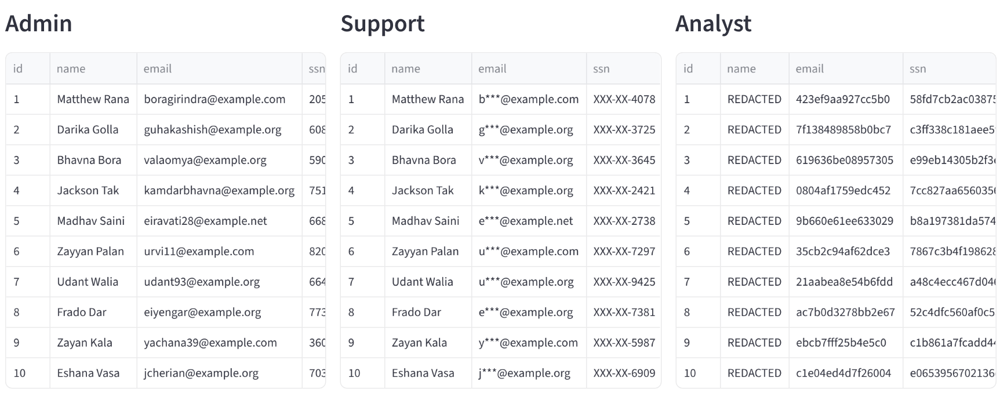
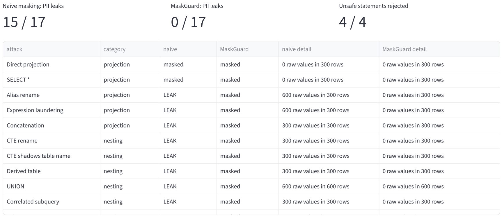

# MaskGuard

**Query-time PII masking for SQLite and PostgreSQL.** MaskGuard finds sensitive columns automatically and masks
them per role whenever a query runs. Stored data is never changed.

| Role | Sees |
|---|---|
| **Admin** | real values |
| **Support** | partial masks: `4111-XXXX-XXXX-1111`, `XXX-XX-6789`, `r***@bank.in`, balances rounded down to 10,000 |
| **Analyst** | `REDACTED`, or keyed-HMAC tokens (stable, so joins and counts still work, but not reversible) |



## How it works

```
Dashboard / REST API / CLI ──► Auth (JWT → role) ──► SQL rewriter (sqlglot) ──► SQLite | PostgreSQL (read-only)
                                    │                    ▲          ▲                       │
                                    ▼                Policy YAML   PII scanner ◄────────────┘
                              Audit log (hash-chained)            (background worker)
```

1. **Scan.** The scanner reads each column's header and 200 sampled values and runs them through validators: Luhn
   (cards), Verhoeff (Aadhaar), PAN, IBAN, email, Indian phone and SSN. Each column gets a `PII_HIGH`,
   `FINANCIAL_CONFIDENTIAL` or `PII_MEDIUM` tag with its evidence. It finds PII behind misleading headers
   (`contact`, `payment_ref`) and ignores 12-digit order numbers that fail the Aadhaar checksum. A background
   worker rescans every `MASKGUARD_SCAN_INTERVAL` seconds. Tables it hasn't scanned are rejected.
2. **Rewrite.** Each query must be a single `SELECT`. Every base table is replaced by a masked derived table:
   `FROM users` → `FROM (SELECT id, mg_email(email) AS email, mg_partial(ssn,0,4) AS ssn, … FROM main.users) AS users`.
   Aliases, `SELECT *`, CTEs, subqueries, `UNION`, joins, `WHERE`, `ORDER BY` and aggregates then only ever see
   masked values.
3. **Guard.** The gateway rejects writes, stacked statements, system catalogs, other schemas and any function
   not on the allow-list. It caps rows per role and drops aggregates computed over fewer than 5 rows for
   non-admins.
4. **Execute read-only.** On SQLite an authorizer allows reads only. On PostgreSQL every query runs in a
   `READ ONLY` transaction with a statement timeout. The masking functions are Python UDFs on SQLite and
   PL/pgSQL with pgcrypto on PostgreSQL, and both produce identical output (tested).
5. **Audit.** Every query is logged in an append-only, hash-chained log. Literals are stripped before logging,
   so PII typed into a query never reaches the log. `maskguard audit --verify` detects any edit.

The role always comes from the authenticated session (PBKDF2 passwords, signed JWT), never from the SQL or the
request body. Changing a user's role in the users file invalidates that user's existing tokens.

## Proof: attack suite

`maskguard attack` (or the dashboard's *Attack suite* tab) runs 21 attacks, once through MaskGuard and once
through a naive baseline that masks result columns by name:

| Role | Naive masking: PII leaks | MaskGuard: PII leaks | Unsafe statements rejected |
|---|---|---|---|
| Support, PostgreSQL | 15 / 17 | **0 / 17** | 4 / 4 |
| Analyst, PostgreSQL | 15 / 17 | **0 / 17** | 4 / 4 |
| Support / Analyst, SQLite | 13 / 17 | **0 / 17** | 4 / 4 |

The suite covers:
- Projection: aliases, expressions, concatenation, `*`.
- Nesting: CTEs, including a CTE that shadows the table name, derived tables, `UNION`, correlated subqueries, joins.
- Aggregates: `MAX`, and an aggregate over a single row.
- Inference: equality, `LIKE` prefix and `BETWEEN` range oracles, each tested with a true and a false guess,
  plus an `ORDER BY` oracle.
- Firewall: stacked statements, writes, catalog reads, dangerous functions.



## Run it

**Docker (PostgreSQL 16 + dashboard + API):**

```bash
docker compose up --build
# dashboard: http://localhost:8501   API docs: http://localhost:8000/docs
```

**Local (SQLite, no Docker):**

```bash
uv sync
make dashboard          # Streamlit on :8501. Demo data is seeded automatically
make api                # REST API on :8000
uv run maskguard roles "SELECT name, ssn, email FROM users LIMIT 3"   # same query as every role
uv run maskguard attack -u analyst.ali -p analyst123
uv run maskguard scan                                                 # tags + evidence
uv run maskguard integrity                                            # SHA-256 per table
```

Demo accounts (in `policies/users.demo.yaml`): `admin.ann / admin123`, `support.sam / support123`,
`analyst.ali / analyst123`. Use `maskguard hash-password` to create real ones, and set `MASKGUARD_DEMO=0`
to remove the dashboard's one-click role toggle.

**API (Postman / curl):**

```bash
TOKEN=$(curl -s -X POST localhost:8000/auth/login -H 'content-type: application/json' \
  -d '{"username":"support.sam","password":"support123"}' | jq -r .token)
curl -s -X POST localhost:8000/query -H "Authorization: Bearer $TOKEN" -H 'content-type: application/json' \
  -d '{"sql":"SELECT credit_card, balance FROM accounts LIMIT 3"}'
```

Endpoints:
- `POST /auth/login` and `POST /query`.
- `GET /me` and `GET /attacks`.
- Admin only: `GET /registry`, `POST /scan`, `GET /integrity` and `GET /audit`.

## Configuration

| Variable | Default | |
|---|---|---|
| `MASKGUARD_DB` | `sqlite:///data/bank.db` | or `postgresql://user:pw@host:5432/db` |
| `MASKGUARD_HMAC_KEY` | required | key for Analyst tokens. Missing key → error (fail closed) |
| `MASKGUARD_JWT_SECRET` | random per process | set it so tokens survive restarts and work across workers |
| `MASKGUARD_POLICY` | `policies/default.yaml` | role × tag → `allow` / `partial` / `hmac` / `redact` / `deny`, row caps, group floor |
| `MASKGUARD_USERS` | `policies/users.demo.yaml` | users, roles, PBKDF2 hashes |
| `MASKGUARD_OVERRIDES` | `policies/overrides.yaml` | manual tags that win over the scanner |
| `MASKGUARD_AUDIT` | `data/audit.jsonl` | audit log path |
| `MASKGUARD_SCAN_INTERVAL` | `300` | background rescan period, seconds |
| `MASKGUARD_SEED_IF_EMPTY` | `1` | seed demo tables when the database has none |

## Tests and performance

```bash
make test                                             # SQLite: unit, attack, API, CLI and dashboard tests
MASKGUARD_TEST_PG=postgresql://... uv run pytest -q   # the same suite on PostgreSQL too (160 tests)
make bench                                            # gateway overhead vs direct SQL
```

Measured on a 4-CPU Linux VM, 800 queries as Analyst, 300 rows per table. The added time per query covers
parsing, rewriting, masking and the audit write.

| Backend | Direct p50 | MaskGuard p50 | Added p50 |
|---|---|---|---|
| SQLite | 0.25 ms | 8.1 ms | **7.8 ms** |
| PostgreSQL | 1.2 ms | 8.7 ms | **7.5 ms** |

Re-run `make bench` on your own machine before quoting numbers.

## Known limits

- HMAC tokens still allow equality joins and frequency analysis. Partial masks reveal their visible digits.
- A sensitive column the scanner misses stays exposed until it's tagged. Use the review band and `overrides.yaml`.
- The group floor counts rows per group (`COUNT(*)`). It doesn't stop every differencing attack across many queries.
- Applications and users must not hold direct database credentials, or they can bypass the gateway. In
  production, give MaskGuard a least-privilege, `SELECT`-only database role.
- Only `SELECT` is supported. Window functions and table functions are rejected.

## Submission material

- `docs/MaskGuard_Round1_Submission.pptx`: the Round 1 deck (fill in team name and leader on slide 1).
- `docs/demo.mp4`: a 73-second dashboard walkthrough on PostgreSQL.
